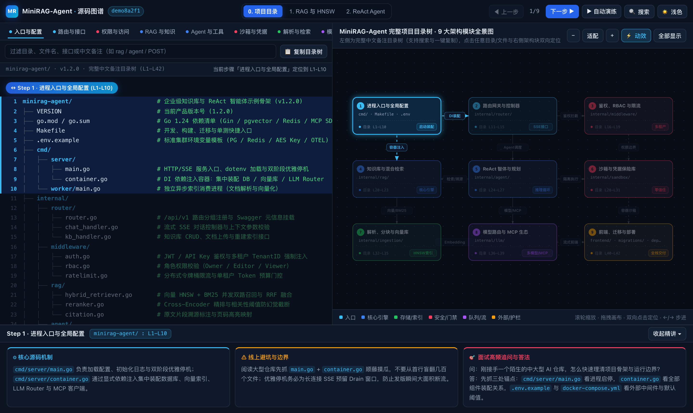
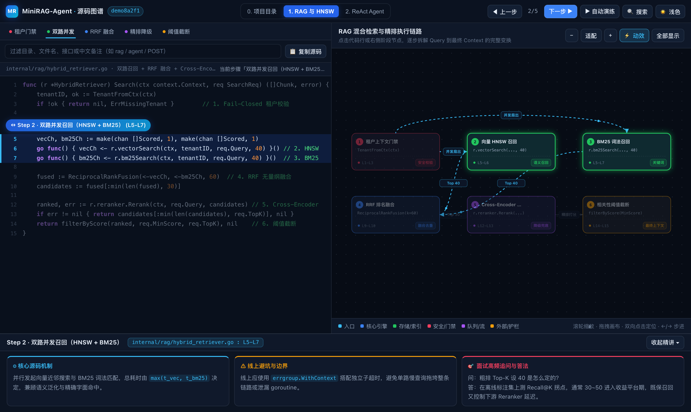
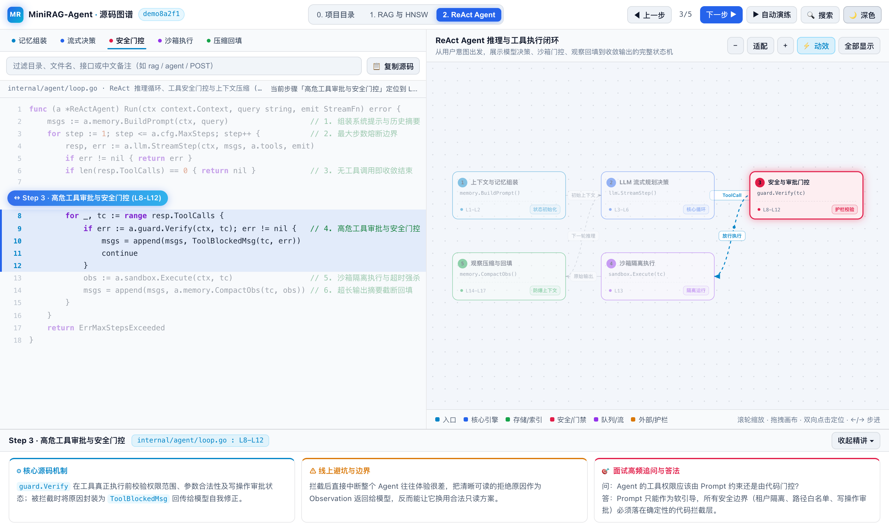

<div align="center">

# 🗺️ Code Atlas Skill (`code-atlas`)

**将任意本地项目或 GitHub 开源仓库，一键（One-shot）生成单文件、零依赖、可交互的「源码 · 架构图谱」HTML**

<p>
  <a href="./skills/code-atlas/SKILL.md"></a>
  
  
  
  <a href="./LICENSE"></a>
</p>

[效果预览](#-效果预览) · [工作原理](#-工作原理) · [核心特性](#-核心特性) · [快速安装](#-快速安装) · [触发示例](#-触发示例) · [快捷键](#-交互与快捷键)

</div>

---

## 🖼️ 效果预览

### 1. 项目目录全景 · 9 大架构模块双向联动（深色主题）

左侧为完整中文备注目录树（支持关键词实时过滤与一键复制），右侧为可缩放拖拽的 SVG 架构全景图，底部随步进同步切换三栏深度精讲：

<p align="center">
  
</p>

### 2. 核心源码执行链路 · 多分支高亮与流动动效

切换至任意专题 Tab（如 `1. RAG 与 HNSW`），点击任意代码行或右侧阶段卡片即可双向定位，自动规避跨列遮挡并伴随脉冲流光动画：

<p align="center">
  
</p>

### 3. 日间浅色主题 · ReAct Agent 状态机闭环

一键切换 `☀️ 浅色 / 🌙 深色` 双套完整视觉 Token，适合文档截图、技术分享与团队评审：

<p align="center">
  
</p>

---

## ⚙️ 工作原理

与纯靠模型“手搓几百行前端代码”不同，本 Skill 将 **真实源码调研规范**、**结构化数据校验** 与 **零依赖单文件渲染引擎** 解耦，大幅提升每次生成的稳定性与准确度：


- **杜绝胡编行号与假文件**：`SKILL.md` 强制要求先读取真实仓库与 `git rev-parse` 提交哈希，再按 Schema 填写真实代码行区间。
- **编译期自动排错**：`build_atlas.py` 自动校验所有 `lines` 区间越界、节点 ID 重复、悬空边引用及缺失的三栏精讲字段，确保输出的 HTML 一次跑通。

---

## ✨ 核心特性

| 模块 | 能力说明 |
| :--- | :--- |
| **多专题 Tab 导航** | `0. 项目目录` 全景模块图 + `1..N` 条核心源码执行链路，一键切换 |
| **双向精准联动** | 点击左侧目录/源码行 ↔ 右侧架构节点霓虹发光定位，带状态同步提示 |
| **可缩放 SVG 画布** | 滚轮以指针为中心缩放、拖拽平移、双击/一键适配、跨列智能拱形绕线、`⚡ 动效` 与「聚焦 / 全部显示」切换 |
| **三栏可折叠精讲** | 每一步同步展示 `⚙ 核心源码机制`、`⚠ 线上避坑与边界`、`🎯 面试高频追问与答法` |
| **效率与演示工具** | `▶ 自动演练`、`⌘K / Ctrl+K` 跨专题全局搜索、左侧实时过滤、一键复制源码/目录树、左右分栏拖拽 |
| **完全离线单文件** | 零外部 CDN / 零构建依赖，生成单个 `.html` 文件发给任何人双击浏览器即看 |

---

## 🚀 快速安装

### 方式 1：使用 `npx skills` 一键安装（推荐）

```bash
npx skills add tsumon/code-atlas-skill
```

### 方式 2：手动安装到本机 Agent 目录

```bash
git clone https://github.com/tsumon/code-atlas-skill.git

# Antigravity 全局 Skill
mkdir -p ~/.gemini/config/skills
cp -r code-atlas-skill/skills/code-atlas ~/.gemini/config/skills/

# Claude Code / Codex / 多 Agent 共享目录
mkdir -p ~/.agents/skills
cp -r code-atlas-skill/skills/code-atlas ~/.agents/skills/
```

### 本地 3 秒试跑内置 Demo

```bash
python3 skills/code-atlas/scripts/build_atlas.py --demo -o ./demo-atlas.html
open ./demo-atlas.html
```

---

## 💬 触发示例

安装完成后，在任意对话中直接这样说即可触发：

> **示例 1（分析开源项目）**
> 「用 `code-atlas` 给 `https://github.com/Tencent/WeKnora` 生成一份交互式源码图谱，重点拆解项目目录、RAG 与 HNSW、ReAct Agent、安全与沙箱。」

> **示例 2（分析当前本地仓库）**
> 「用 `code-atlas` 梳理当前项目，生成一份带核心链路和面试追问的交互式架构图谱 HTML。」

> **示例 3（新人入职 / 技术分享）**
> 「用 `code-atlas` 把这个服务的订单支付与异步补偿链路做成可逐步演练的源码图谱。」

---

## ⌨️ 交互与快捷键

| 操作 / 快捷键 | 功能 |
| :--- | :--- |
| `←` / `→` | 上一步 / 下一步源码演练 |
| `Cmd + K` / `Ctrl + K` | 打开跨专题全局搜索（检索目录、代码行、避坑与面试题） |
| `滚轮` / `左键拖拽` / `双击画布` | 缩放画布 / 平移画布 / 一键适配居中 |
| `点击任意代码行或右侧节点` | 双向高亮定位并同步底部三栏精讲 |
| `点击底栏标题` | 折叠 / 展开三栏精讲抽屉 |

---

## 📁 仓库结构

```text
code-atlas-skill/
├── README.md                          # 项目说明与效果展示
├── LICENSE                            # MIT 开源协议
├── docs/
│   └── assets/                        # README 高清预览图（深色目录 / 源码链路 / 浅色主题）
└── skills/
    └── code-atlas/
        ├── SKILL.md                   # Skill 主指令与 4 阶段工作流
        ├── assets/
        │   └── template.html          # 单文件交互式图谱渲染引擎（零外部依赖）
        ├── scripts/
        │   └── build_atlas.py         # JSON Schema 强校验器 + 单文件 HTML 编译器
        ├── references/
        │   ├── data-schema.md         # atlas-data.json 字段与布局规范
        │   └── design-spec.md         # 视觉配色与交互规范
        └── examples/
            └── demo-data.json         # 内置可运行 3 专题 / 9 模块完整示例数据
```

---

## 📄 License

Released under the [MIT License](./LICENSE).
