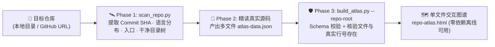

<div align="center">

# 🗺️ Code Atlas Skill (`code-atlas`)

**将任意本地项目或 GitHub 开源仓库，一键（One-shot）生成单文件、零依赖、可交互的「源码 · 架构图谱」HTML**

<p>
  <a href="https://tsumon.github.io/code-atlas-skill/"></a>
</p>

<p>
  <a href="./skills/code-atlas/SKILL.md"></a>
  
  
  
  
  <a href="./LICENSE"></a>
</p>

[🚀 在线交互体验](https://tsumon.github.io/code-atlas-skill/) · [效果预览](#-效果预览) · [防幻觉架构](#-工作原理与防幻觉闭环) · [核心特性](#-核心特性) · [快速安装](#-快速安装) · [触发示例](#-触发示例)

</div>

---

## 🚀 在线交互体验（Live Demo）

无需安装任何依赖，直接点击体验由本 Skill 针对真实开源仓库生成并经 `--repo-root` 校验通过的图谱：

- 👉 **[Tencent/WeKnora v0.9.0 真实源码图谱（4 专题 · 跨多文件链路 · GitHub 原文直达）](https://tsumon.github.io/code-atlas-skill/)**
  - 直达示例：[RAG 精排与倒排 MMR](https://tsumon.github.io/code-atlas-skill/#tab=1&step=3) · [ReAct Agent 读写屏障并发](https://tsumon.github.io/code-atlas-skill/#tab=2&step=4) · [SSRF 防 DNS 重绑定](https://tsumon.github.io/code-atlas-skill/#tab=3&step=3)
- 👉 **[MiniRAG-Agent 轻量示例图谱（内置 `--demo`）](https://tsumon.github.io/code-atlas-skill/demo.html)**

---

## 🖼️ 效果预览

### 1. 项目目录全景 · 9 大架构模块双向联动（WeKnora v0.9.0 实测）

左侧为经 `scan_repo.py` 扫描生成的完整中文备注目录树（支持实时过滤与一键复制），右侧为可缩放拖拽的 SVG 架构全景图，底部随步进同步切换三栏精讲与一键导出笔记：

<p align="center">
  
</p>

### 2. 跨多文件真实链路 · 自动切文件 + `↗ GitHub 原文` 直达

单专题 Tab 支持挂载多个真实源文件（如 `composite.go` → `rerank.go` → `mmr.go`），步进或点击节点时自动切换左侧文件并高亮真实行号，一键直达 GitHub 对应 Commit 源码行：

<p align="center">
  
</p>

### 3. 日间浅色主题 · ReAct Agent 读写屏障并发执行

一键切换 `☀️ 浅色 / 🌙 深色` 双套主题，支持 `⬇ SVG` 矢量图导出、`📝 导出笔记`（Markdown 面试精讲）与 `🔗` URL Hash 步骤直达分享：

<p align="center">
  
</p>

---

## ⚙️ 工作原理与防幻觉闭环

区别于让模型纯手写易错 HTML 的传统做法，本 Skill 内置 **「预扫描 → 真实源码精读 → 落盘真实验证 → 单文件编译」** 四阶段闭环：



- **大仓库省 60%+ Token**：`scripts/scan_repo.py` 自动过滤 `node_modules/.git/dist/vendor` 等噪音目录，一键输出版本、Commit SHA、入口文件候选与规整目录树。
- **工具层杜绝编造文件**：`scripts/build_atlas.py --repo-root <repo>` 编译期自动检查 JSON 里每个 `filePath` 在真实磁盘上是否存在、`realLines` 是否越界，彻底堵死模型幻觉。

---

## ✨ 核心特性

| 模块 | 能力说明 |
| :--- | :--- |
| **多专题 + 跨多文件联动** | `0. 项目目录` 全景模块图 + `1..N` 条核心链路；单 Tab 支持跨多源文件自动切换与 `↗ GitHub 原文` 精准行号直达 |
| **智能防碰撞 SVG 画布** | 滚轮指针缩放、拖拽平移、一键适配、**同侧多边自动分散锚点（Port Spreading）**、**跨列/跨行智能拱形绕线**、`⚡ 动效` 开关 |
| **三栏可折叠精讲面板** | 每一步同步展示 `⚙ 核心源码机制`、`⚠ 线上避坑与边界`、`🎯 面试高频追问与答法` |
| **分享与一键导出** | **URL Hash 精确定位**（`#tab=1&step=3`）与 `🔗` 一键复制链接；**`⬇ SVG`** 导出当前架构图；**`📝 导出笔记`** 导出全站 Markdown 面试精讲 |
| **演示与搜索效率工具** | `▶ 自动演练`、`⌘K / Ctrl+K` 跨专题跨文件全局搜索、左侧实时过滤、一键复制源码/目录树、左右分栏自由拖拽 |
| **完全离线单文件** | 零外部 CDN / 零构建依赖，生成单个 `.html` 文件发给任何人双击浏览器即看，也可直接挂 GitHub Pages |

---

## 🚀 快速安装

### 方式 1：使用 `npx skills` 一键安装（推荐）

```bash
npx skills add tsumon/code-atlas-skill
```

### 方式 2：手动安装到本机 Agent 目录

```bash
git clone https://github.com/tsumon/code-atlas-skill.git

# Antigravity 全局 Skill
mkdir -p ~/.gemini/config/skills
cp -r code-atlas-skill/skills/code-atlas ~/.gemini/config/skills/

# Claude Code / Codex / 多 Agent 共享目录
mkdir -p ~/.agents/skills
cp -r code-atlas-skill/skills/code-atlas ~/.agents/skills/
```

### 本地命令行工具速览

```bash
# 1. 预扫描任意本地仓库（省 Token + 提取真实 Commit / 目录骨架）
python3 skills/code-atlas/scripts/scan_repo.py /path/to/your-repo --max-depth 3

# 2. 校验真实文件与行号，编译单文件 HTML 图谱
python3 skills/code-atlas/scripts/build_atlas.py atlas-data.json --repo-root /path/to/your-repo -o ./repo-atlas.html

# 3. 3 秒试跑内置 Demo
python3 skills/code-atlas/scripts/build_atlas.py --demo -o ./demo-atlas.html && open ./demo-atlas.html
```

---

## 💬 触发示例

安装完成后，在任意对话中直接这样说即可触发：

> **示例 1（分析开源项目）**
> 「用 `code-atlas` 给 `https://github.com/infiniflow/ragflow` 生成一份交互式源码图谱，重点拆解项目目录、文档解析、混合检索与 Agent 工作流。」

> **示例 2（分析当前本地仓库）**
> 「用 `code-atlas` 梳理当前项目，生成一份带跨文件执行链路和面试追问的交互式架构图谱 HTML。」

> **示例 3（新人入职 / 架构评审）**
> 「用 `code-atlas` 把这个服务的鉴权、限流与订单异步补偿链路做成可逐步演练的源码图谱，顺便能导出 SVG 和 Markdown 笔记。」

---

## ⌨️ 交互与快捷键

| 操作 / 快捷键 | 功能 |
| :--- | :--- |
| `←` / `→` | 上一步 / 下一步源码演练 |
| `Cmd + K` / `Ctrl + K` | 打开跨专题、跨文件全局搜索（检索目录、代码行、避坑与面试题） |
| `滚轮` / `左键拖拽` / `双击画布` | 以指针为中心缩放 / 平移画布 / 一键适配居中 |
| `点击任意代码行或右侧节点` | 双向高亮定位、自动切换源文件并同步底部三栏精讲 |
| `🔗` / `⬇ SVG` / `📝 导出笔记` | 复制当前步骤直达链接 / 导出架构矢量图 / 导出全量 Markdown 笔记 |

---

## 📁 仓库结构

```text
code-atlas-skill/
├── README.md                          # 项目说明、Live Demo 入口与高清预览
├── LICENSE                            # MIT 开源协议
├── docs/
│   ├── index.html                     # GitHub Pages 在线 Demo（WeKnora v0.9.0 真实源码图谱）
│   ├── demo.html                      # GitHub Pages 内置轻量示例（MiniRAG-Agent）
│   └── assets/                        # README 2x Retina 实机预览截图
└── skills/
    └── code-atlas/
        ├── SKILL.md                   # Skill 主指令与 4 阶段防幻觉工作流
        ├── assets/
        │   └── template.html          # 单文件交互图谱引擎（多文件/Port Spreading/Hash/导出）
        ├── scripts/
        │   ├── scan_repo.py           # 零依赖仓库预扫描脚本（Commit/入口/干净目录树）
        │   └── build_atlas.py         # Schema + --repo-root 真实性校验器与单文件编译器
        ├── references/
        │   ├── data-schema.md         # 单文件/多文件 JSON Schema 与自定义边路由规范
        │   └── design-spec.md         # 视觉配色 Token 与交互规范
        └── examples/
            ├── weknora-atlas.json     # Tencent/WeKnora v0.9.0 真实源码图谱数据集
            └── demo-data.json         # MiniRAG-Agent 轻量示例数据集
```

---

## 📄 License

Released under the [MIT License](./LICENSE).
